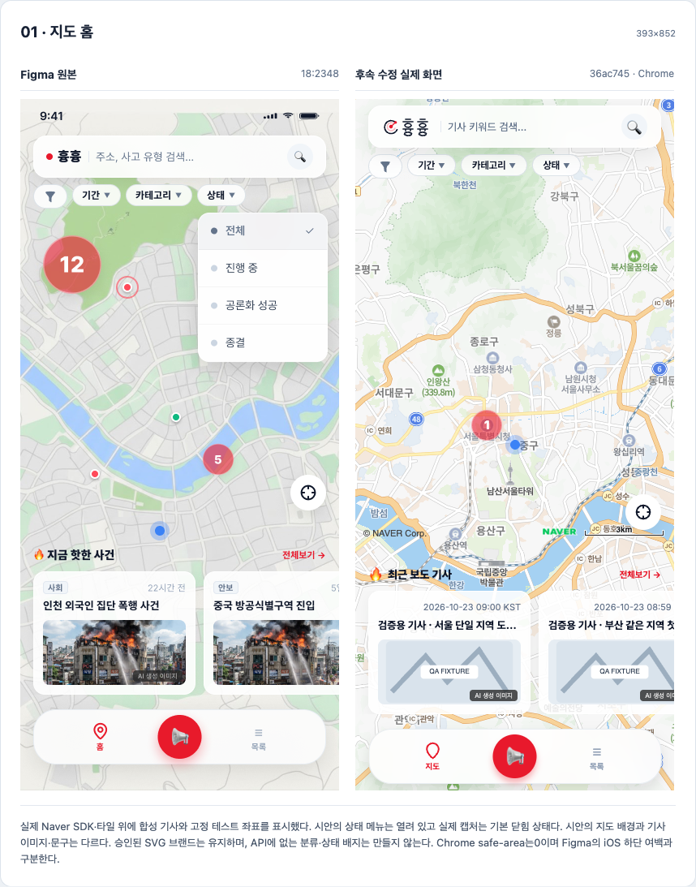
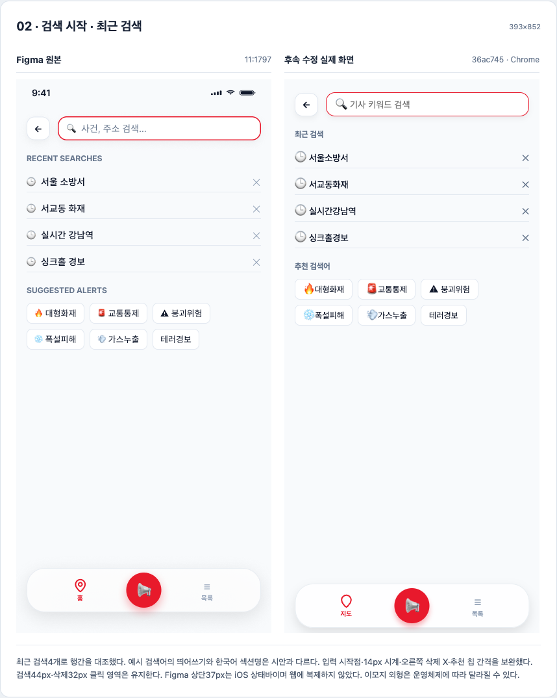
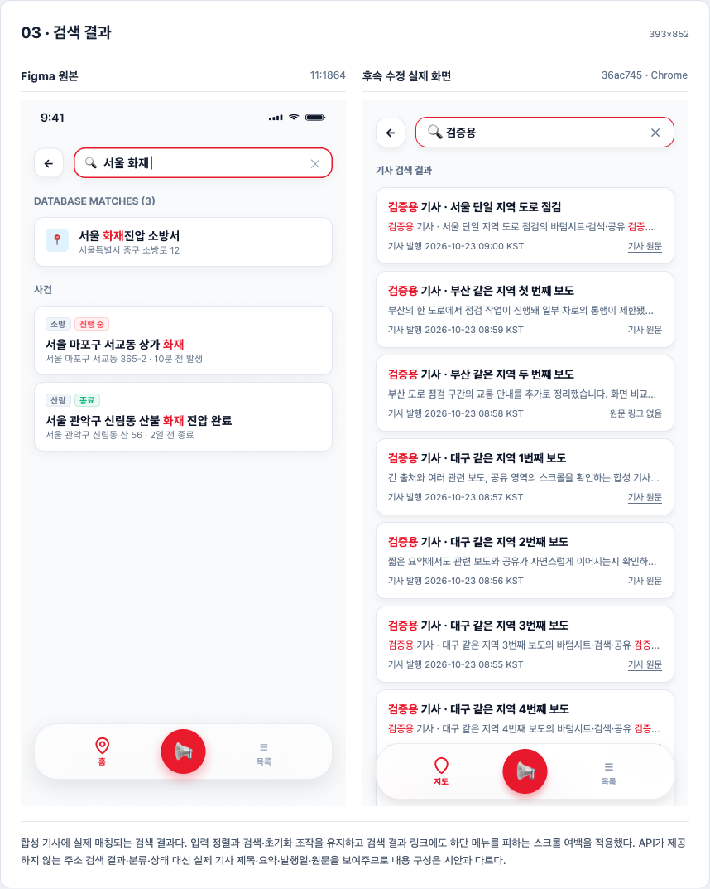
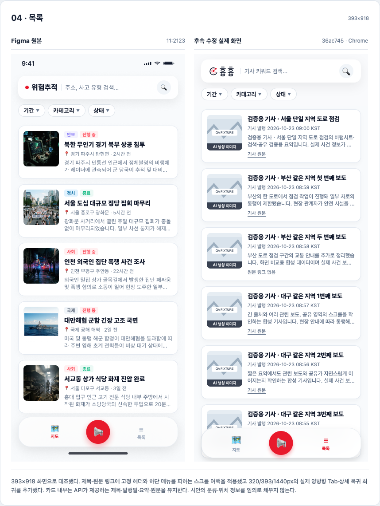
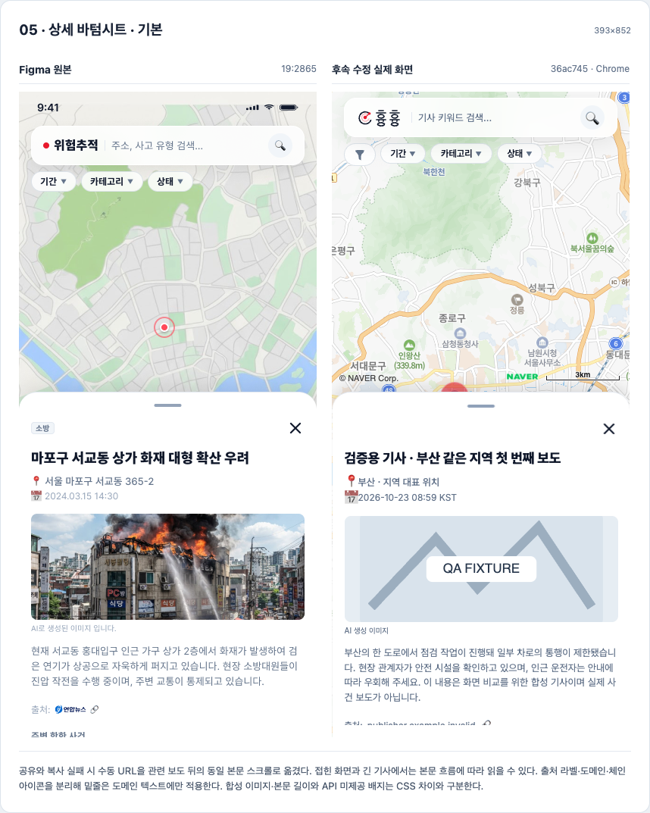
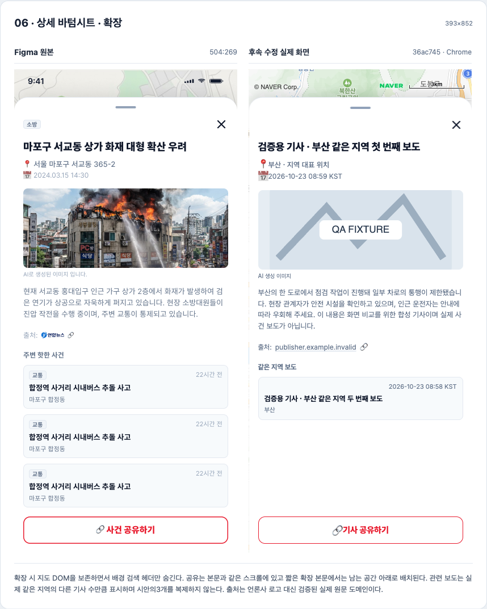
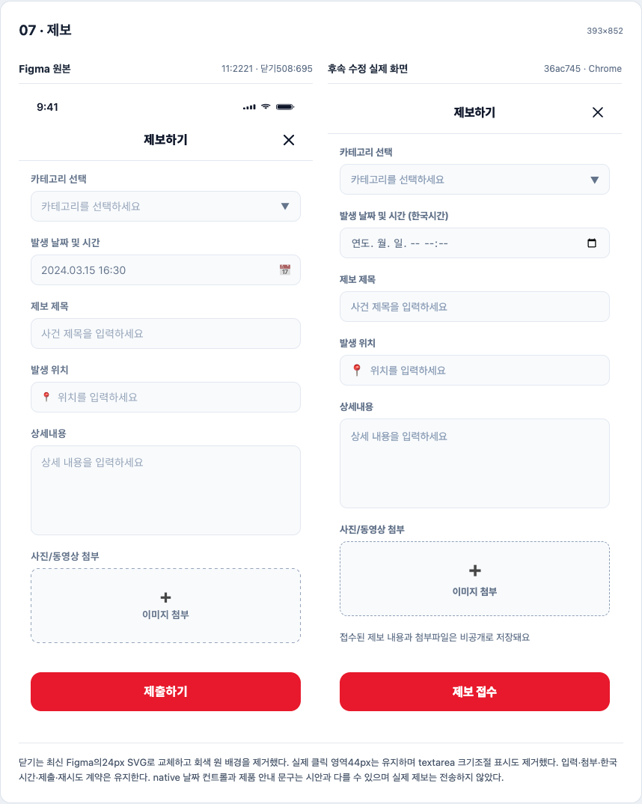

# PR45 최종 Figma 대조

제품 소스36ac745 · Build0yLuwuFKYffar7_ftmQYn. 왼쪽은 Figma, 오른쪽은 가공하지 않은 실제 Chrome 캡처다. 원본393px 표시 폭과 PNG 해시를 보존했다. 전체140개 테스트와 최종 시각/동작37개 결과는 상위 검증 기록을 참고한다.

Figma의 iOS 상태바·safe-area, 실제 Naver 지도 배경, 합성 기사와 OS 이모지는 CSS 오차와 구분한다. API에 없는 분류·상태·정확 주소·언론사 로고를 채우지 않았다. 치수 통과를 전체 픽셀 일치로 주장하지 않는다.

## 지도 홈

실제 Naver SDK·타일 위에 합성 기사와 고정 테스트 좌표를 표시했다. 시안의 상태 메뉴는 열려 있고 실제 캡처는 기본 닫힘 상태다. 시안의 지도 배경과 기사 이미지·문구는 다르다. 승인된 SVG 브랜드는 유지하며, API에 없는 분류·상태 배지는 만들지 않는다. Chrome safe-area는0이며 Figma의 iOS 하단 여백과 구분한다.

## 검색 시작 · 최근 검색

최근 검색4개로 행간을 대조했다. 예시 검색어의 띄어쓰기와 한국어 섹션명은 시안과 다르다. 입력 시작점·14px 시계·오른쪽 삭제 X·추천 칩 간격을 보완했다. 검색44px·삭제32px 클릭 영역은 유지한다. Figma 상단37px는 iOS 상태바이며 웹에 복제하지 않았다. 이모지 외형은 운영체제에 따라 달라질 수 있다.

## 검색 결과

합성 기사에 실제 매칭되는 검색 결과다. 입력 정렬과 검색·초기화 조작을 유지하고 검색 결과 링크에도 하단 메뉴를 피하는 스크롤 여백을 적용했다. API가 제공하지 않는 주소 검색 결과·분류·상태 대신 실제 기사 제목·요약·발행일·원문을 보여주므로 내용 구성은 시안과 다르다.

## 목록

393×918 화면으로 대조했다. 제목·원문 링크에 고정 헤더와 하단 메뉴를 피하는 스크롤 여백을 적용했고 320/393/1440px의 실제 양방향 Tab·상세 복귀 회귀를 추가했다. 카드 내부는 API가 제공하는 제목·발행일·요약·원문을 유지한다. 시안의 분류·위치 정보를 임의로 채우지 않는다.

## 상세 바텀시트 · 기본

공유와 복사 실패 시 수동 URL을 관련 보도 뒤의 동일 본문 스크롤로 옮겼다. 접힌 화면과 긴 기사에서는 본문 흐름에 따라 읽을 수 있다. 출처 라벨·도메인·체인 아이콘을 분리해 밑줄은 도메인 텍스트에만 적용한다. 합성 이미지·본문 길이와 API 미제공 배지는 CSS 차이와 구분한다.

## 상세 바텀시트 · 확장

확장 시 지도 DOM을 보존하면서 배경 검색 헤더만 숨긴다. 공유는 본문과 같은 스크롤에 있고 짧은 확장 본문에서는 남는 공간 아래로 배치된다. 관련 보도는 실제 같은 지역의 다른 기사 수만큼 표시하며 시안의3개를 복제하지 않는다. 출처는 언론사 로고 대신 검증된 실제 원문 도메인이다.

## 제보

닫기는 최신 Figma의24px SVG로 교체하고 회색 원 배경을 제거했다. 실제 클릭 영역44px는 유지하며 textarea 크기조절 표시도 제거했다. 입력·첨부·한국시간·제출·재시도 계약은 유지한다. native 날짜 컨트롤과 제품 안내 문구는 시안과 다를 수 있으며 실제 제보는 전송하지 않았다.

## 추가 상황

[긴 출처와 밑줄](compare-extra-long-source.png) · [복사 실패 URL](compare-extra-manual-url.png) · [원문 없음](compare-extra-no-source.png) · [숫자 원](compare-extra-map-counts.png) · [빈 검색](compare-extra-empty-search.png) · [긴 본문 처음](compare-extra-long-before-scroll.png) · [긴 본문 스크롤 후](compare-extra-long-after-scroll.png)

[원본 해시와 조건](comparison-manifest.json) · [렌더 검증](render-report.json)
