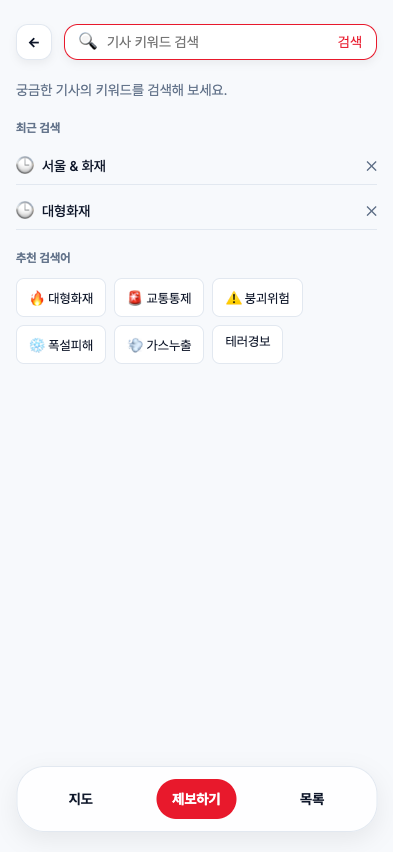

# 최근 검색 최종 검증

2026-10-11 · 제품·테스트 검증 및 독립 리뷰 HEAD `13d125a7e156f6168d04c03acc4cf9f164d5c5d6`.

- 사용자 승인한 명세와 신규 6개 테스트를 sobaya Astra로 진행했다. 기존 40개 테스트·helpers·fixtures·명령과 의존성은 변경하지 않았다.
- 최초 3개 항목은 실제 행동 RED → Astra 구현 → 전체 suite GREEN 체크포인트(0416019·caa7701·0679a6b)를 완료했다.
- jsdom의 `&` 포함 속성 선택자 결함은 React 없는 최소 재현과 실제 Chrome으로 구분했다. 사용자가 승인한 조회 문법만 교체했다. 기대 동작·접근성 이름·의존성은 유지했고 이전 승인 상태는 approvals/에 보관됐다. 새 baseline은 `7bff203c623129b98d06b84d65ff4b194e4818ee`다.
- 네 번째·다섯 번째 항목은 ALREADY GREEN으로 검증·체크포인트를 완료했다. 최종 gate의 전체 46개 테스트·Format·Lint가 통과했다. 자정을 넘긴 최초 gate에서 기존 harness_loop 한 건이 실패했으나, 코드 변경 없이 단독 재검증과 최종 gate가 통과했다. 테스트 날짜와 종료 검사 날짜가 다를 수 있는 구조를 확인했다.
- Astra 첫 독립 리뷰의 고립 surrogate URIError 지적에 따라 사용자가 정확 여섯 번째 회귀 테스트를 승인했다. 실제 RED를 확인하고 sobaya Astra로 수정했으며 정상 Unicode·이모지 보존을 포함해 전체 46개 테스트를 검증했다.
- `status`: complete, active 없음, pending 없음, dirty false. Astra 독립 리뷰는 전체 origin/dev..HEAD 변경을 읽은 새 컨텍스트에서 완료했으며 리뷰 HEAD는 위 커밋과 동일하다. 결과는 evidence/review.json에 보존했다.
- 최종 전체 src 44개 파일과 같은 별도 복사본에서 TypeScript 검사와 `pnpm exec next build --webpack` 프로덕션 빌드가 통과했다. 승인된 Unicode 회귀 테스트까지 포함해 타입 검사를 확인했다.
- 실제 Chrome에서 폼·추천·최근 링크, 최신 순·중복 제거, 삭제 시 URL 이동·API 요청 없음, 새로고침 후 삭제 유지, 실패/빈 결과 검색 기록, 저장값 trim·중복 정리·최대 10개 복원, 고립 surrogate 무시·정상 이모지 보존, HTML 문자열의 텍스트 출력과 저장소 접근/쓰기 차단 시 기존 검색 유지를 확인했다. pageerror는 없었다.
- 320·393·1280px에서 가로 넘침이 없고 긴 검색어가 한 줄 말줄임으로 표시되며 삭제 버튼이 화면 안에 남는다. 최근 검색 행의 테두리 너비는 위·오른쪽·아래·왼쪽 순서로 0·0·1·0px이며 Figma 하단 구분선을 확인했다. 스크린샷을 직접 확인했다.

## 재현 자료와 범위

evidence/api-mock.mjs와 evidence/browser-qa.mjs는 로컬 QA fixture다. API를 3820 포트에서 실행하고 별도 앱 복사본을 NEWS_API_BASE_URL=http://127.0.0.1:3820으로 빌드·3821 포트에서 실행한 뒤 browser-qa.mjs를 실행한다. 실제 서버/API 계약 확인을 대체하지 않는다.

Figma 11:1814 최근 검색 영역만 구현했다. 주소 검색·전체 삭제·탭 간 즉시 동기화·지도 사건 마커·상세·제보는 범위 밖이다. docs/map-api-contract.md는 확정 스키마가 아닌 API 확인 항목이다. 최종 인수인계 커밋은 검증된 제품·테스트 코드를 바꾸지 않고 명세 보관·저널·claim·검증 자료만 담는다.
