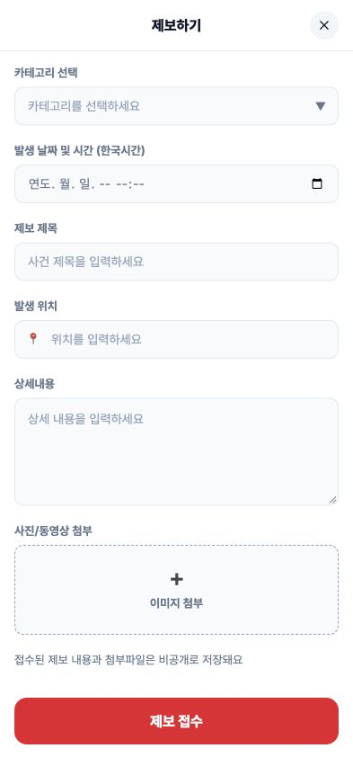

# 제보 화면 피그마 마감 검증

2026-10-15 · 기준 dev `119172afa3eb5b9cbe62ea18a58e4514a58e278f`.

## 다음 작업 선정 근거

PR18·서버 PR3과 공통 UI PR19, dev→main PR20은 모두 병합됐다. 운영은 10월15일11:28의 새 Vercel 배포로 갱신돼 있어 다시 배포할 필요가 없었다. 오늘08:00 수집은 systemd Result=success/ExecMainStatus=0이며 fire/traffic/collapse/flood 네 완료 기록이 있다. 운영 GET 결과는 기사82건, 지도용 resolved3건이다. 위치 재현율 한계와 수집 장애를 구분했고 서버 로직은 변경하지 않았다.

기존 `docs/work-split.md`의 amazon 담당 중 PR19의 `visual-verification.md`가 미완료로 명시한 제보 본문을 선택했다. 목록 카드는 검색과 공유하고, 지역 숫자 원은 다른 담당의 후속 범위이므로 이번 변경은 제보 화면 하나에 한정한다. 새로운 배정이 생겼다고 주장하지 않는다.

## 디자인 근거와 변경

[Figma 제보 11:2221](https://www.figma.com/design/TCSILMzViAVqeHRphoyHCH?node-id=11-2221)의 high fidelity React 컨텍스트와393px 렌더를 직접 확인했다. 기존 Inter/Pretendard, 색 토큰, 흰 전용 AppShell, ReportPage 상태 처리를 재사용한다.

- 헤더57px·닫기 원32px 유지, 실제 클릭 영역44px로 확장.
- 카테고리는 native select를 유지하고43px 높이·시안의 텍스트 화살표를 적용. 날짜 입력도 native datetime-local과 한국시간 의미를 유지.
- 제목·위치 입력43px, 위치의 원본 텍스트 아이콘📍, 상세120px, 업로드100px와18px 텍스트 아이콘➕를 적용.
- 폼 본문과 하단 액션 영역을 구분한다.52px 제출 버튼·하단24px 안전 여백을 유지하고, 긴 화면에서는 아래쪽으로 배치하며 짧은 화면에서는 문서와 함께 스크롤한다. fixed/sticky로 필드를 가리지 않는다.
- 필수 입력 오류, 비공개 접수 안내, `제보 접수`/`접수 중` 문구, 실제 접수번호·재시도·새 제보는 기존 기능 계약대로 유지한다. 기기 상태바·샘플 날짜를 제품 데이터로 넣지 않는다. native 날짜 UI는 브라우저별로 다를 수 있다.

Figma에 이 화면의 제품용 이미지/SVG 자산은 없으며 장식은 텍스트다. 상태바의 iOS signal/Wi-Fi/battery 세 SVG는 기기 목업이라 사용하지 않는다. 로컬 공통 폰트와 native 날짜 아이콘을 재사용하며 임시 Figma URL·새 의존성·공용 스타일 변경은 없다.

## 검증 범위

변경 전393×852에서 select/date45px, 위치 아이콘 없음, 업로드의 작은 전각＋, 제출 버튼 아래 빈 공간을 관찰했다. 변경 후 field43px·textarea120px·upload100px·submit52px·닫기44px를 DOM으로 실측하고 렌더와 대조했다. 시각 수정이라 CSS 문자열을 따라 쓰는 테스트는 추가하지 않았으며 기존 의미 있는 회귀 suite를 사용한다.

- 기존 form/recovery **17테스트 PASS**. 반환 JSX 이전의 입력 검증·상태·fetch·타이머·멱등키·취소 로직은 diff에 없다.
- 실제 브라우저 빈 제출 → 첫 오류 필드(category) 포커스, 전체 필수 항목 오류 안내 확인.
- synthetic 입력값으로 카테고리/날짜/제목/위치/상세 입력 → 로컬 API 미설정 안내 → 오류 닫기 후 입력 보존 확인. 운영 접수 환경변수를 넣지 않았고 실제 제보를 제출하지 않았다.
- 320×700: 모든 입력 너비288px, 가로 overflow 없음, 스크롤 후 제출 버튼 y624–676/높이52px로 조작 가능.
- 667×375: 가로 overflow 없음, 스크롤 후 제출 y299–351/높이52px, footer는static이며 첨부를 덮지 않음.
- 독립 읽기 전용 검토에서 동일 form 소속·FormData·form.elements·새 제보 reset 연결, 장식의 aria-hidden/pointer-events-none, 닫기 영역·border-box를 확인했고 회귀 지적 없음.

## 최종 결과

- `pnpm exec vitest run`: **24파일·102테스트 PASS**, 166.85초. 로그의 가상 동료 button.tsx 편집 알림은 협업 테스트 fixture에서 나온 출력이며 실제 이 작업의 파일 충돌이 아니다.
- `pnpm run format:check`, `pnpm run lint`, `pnpm run typecheck`, `sh scripts/check-styles.sh`, `pnpm run build`, `git diff --check`: PASS.
- 프로덕션 빌드의 `next start`에서도 393×852 화면을 확인했다. 입력43px·상세120px·제출52px, 제출 y776–828과 하단24px, scrollWidth393을 실측했다. 닫기 링크로 `/` 이동도 확인했다.
- [최종 모바일 캡처](evidence/report-393.png), [전체 테스트](evidence/suite.txt), [빌드](evidence/build.txt), [정적 검사](evidence/static-checks.txt).
- 모바일 OS 키보드·실기기 safe-area는 미검증이다. 실제 서버로 새 제보를 보내는 검사는 수행하지 않았으며 기존 접수/복구 회귀 테스트와 로컬 오류 복구로 이번 시각 변경의 범위를 확인했다.

## 환경과 보존

`collab.sh check`는 통과했으나 과거 원격 claim과의 파일 겹침을 알렸다. `origin/codex/project-foundation`은10월1일 마지막 커밋176948f·status paused이며, `origin/codex/product-gap-audit`는10월7일 마지막 커밋c551c89·문서 점검 전용 claim이다. GitHub 열린 PR은 없고 이번 실제 dev 대비 제품 diff는 report/page.tsx 하나다. 과거 브랜치 이력을 현재 병렬 구현으로 해석하지 않았으며 상대 claim·공유 검사기를 수정하지 않았다.

새 worktree의 최초 claim 커밋은 node_modules가 없어 formatter 실행에 실패했다. 기존 lockfile 그대로 pnpm install --frozen-lockfile 후 정상 훅으로 커밋했다. next dev가 덧붙인 AGENTS.md 블록은 `next/dist/server/lib/generate-agent-files.js`로 출처를 확인했고, dev 종료 후 원래 파일과 next-env.d.ts를 복원했다. 기존 spec·테스트·dependencies·하네스 pin·공유 훅·완료 저널은 수정하지 않는다.

별도 채팅의 Canon TDD 런타임 전환 조율 메시지는 받았으나 이 작업에서 공유 런타임을 바꾸지 않는다. 이 checkout은 직접 시각 편집과 기존 테스트 검증만 수행하므로 활성 step/loop 시도나 새 spec.md가 없다. 최종 GREEN/커밋 후 전환 대상은 이 새 checkout과 기존 install/pin을 구분해서 결정할 수 있다.
