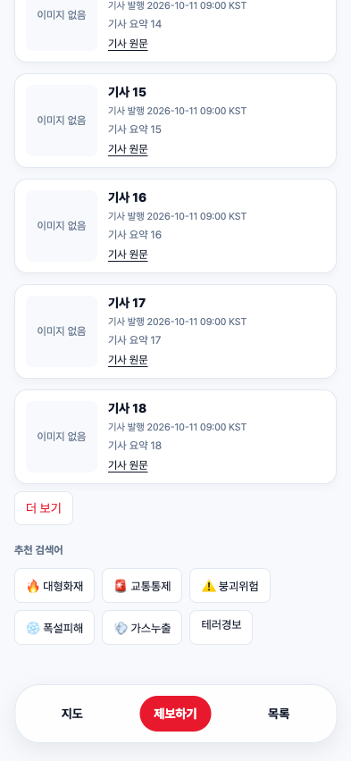

# 검색 더 보기 검증

2026-10-11 · 제품/테스트 검증 및 독립 리뷰 HEAD `dc483848849960a0fd6d9d8f9965dc81511e3b95`.

- 사용자 전과정 승인 범위의 신규 4개 테스트를 각각 실제 assertion RED로 probe하고 전체 초안 타입 검사를 통과했다. 기존 54개 테스트 본문·helpers·fixtures·명령·의존성은 그대로 유지했다.
- sobaya Astra가 승인 항목별 구현·전체 suite GREEN·체크포인트를 수행했다. 첫 소스의 포맷 오류는 해당 소스만 Prettier로 정리한 뒤 승인 입력 변경 없이 --resume으로 재개했다.
- 마지막 항목의 최초 회귀 검사와 진단 실행에서 기존 harness_loop가 120초 제한을 넘겼다(진단은 57개 통과·시간 초과 1개). 테스트 제한·기대값·명령을 바꾸지 않고 검증용 서버를 종료한 뒤 원래 절차를 재개했다. 별도 셸 직접 실행은 테스트가 제거하는 CLAUDE_PROJECT_DIR을 상속해 유효한 완료 근거로 사용하지 않았다.
- 최종 gate의 전체 58개 테스트, Format, Lint 및 새로운 읽기 전용 Astra 독립 리뷰를 통과했다. 리뷰는 전체 origin/dev..HEAD를 검토했고 결과를 evidence/review.json에 보관했다.
- 실제 최종 src와 파일 내용이 같은 임시 복사본에서 TypeScript 검사와 Next.js 프로덕션 빌드를 통과했다. 원본 작업 공간에서 Next dev를 실행하거나 승인 계약을 자동 변경하지 않았다.
- Chrome에서 같은 앱 서버 경계를 거쳐 API fixture로 다음 흐름을 확인했다: 원본 offset 0/20/40, 페이지 내·페이지 사이 중복 제거, 마지막/빈 페이지 종료, 중복만 있는 페이지의 다음 조회, 로딩·기존 카드 유지·실패한 offset 재시도, 검색어 변경, 상세 진입·뒤로가기, 초기화·빈 결과. 320/393/1280px 가로 넘침과 브라우저 pageerror가 없었다. 브라우저에서 별도 API 서버로 직접 요청하지 않았다.
- 신규 UI의 스타일은 기존 Tailwind 토큰을 사용한다. 더 보기 버튼·상태 표시는 이번 동작 범위이며 별도의 확정 Figma 더 보기 노드가 있다고 주장하지 않는다.

## 재현과 한계

evidence/api-mock.mjs는 localhost 3824에서 고정 기사 페이지와 오류를 제공한다. 별도 앱 복사본을 NEWS_API_BASE_URL=http://127.0.0.1:3824으로 빌드해 3825에서 실행한 뒤 evidence/browser-qa.mjs를 실행한다. fixture 검증은 운영 서버에 40개 이상 데이터가 있거나 지속 수집이 동작함을 보증하지 않는다.

목록 화면은 기존 첫 페이지 동작을 유지한다. 목록 더 보기·지도 좌표·필터·제보·API 스키마와 새로운 의존성은 범위 밖이다. 마지막 인수인계 커밋은 검증한 제품·테스트 소스를 바꾸지 않고 저널·claim·명세 보관·검증 자료만 포함한다.
